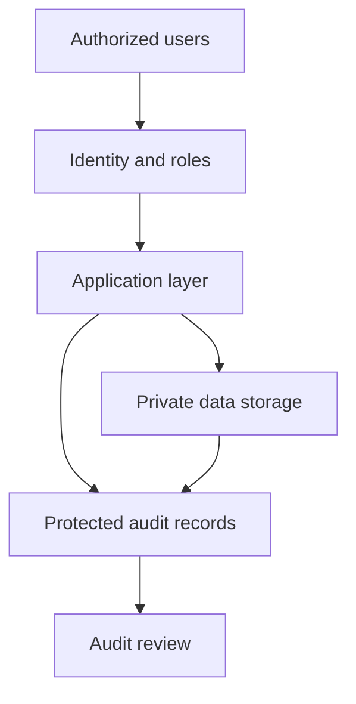

# Architecture review

Logical model only. Requirements: individual identities, constrained permissions, encrypted storage and communication, protected evidence, recovery ownership and review. No network exposure or account provisioning is implied.
